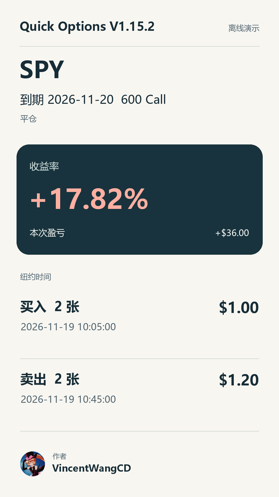

# IBKR Quick Options

**VincentWangCD** · Windows · v1.15.2 · [中文使用说明](README.md#中文使用说明)

A bilingual Windows desktop tool for US equity and index options on Interactive Brokers. Browse option chains, size entries by budget, manage positions through TWS or IB Gateway, and review execution history with IBKR Flex. The trading workflow supports standard USD options with a 100 multiplier.

The account selector starts on **IBKR Live**, followed by **IBKR Paper** and **Offline Demo**. Click **Connect / Start** to connect to your selection. To try the interface with synthetic quotes and funds, select Offline Demo first.

Click **English** in the top-right corner to switch the running tool to English. Click **简体中文** to switch back. Your choice is remembered on this computer.

## Install on Windows

1. Install 64-bit Python 3.11 from [python.org](https://www.python.org/downloads/windows/). Select **Add python.exe to PATH** in the installer.
2. Download the source ZIP from the repository's **Releases** or **Code → Download ZIP**. Extract it to a writable folder. Open the folder containing `install.bat`.
3. Double-click `install.bat`. It creates a local `.venv` and installs the pinned dependencies in `requirements.txt`, including ib_async, tzdata and Pillow. Wait for **Installation complete**.
4. Double-click `start.bat`. Select **Offline demo (simulated quotes)** and click **Connect / Start** to try the workflow. Offline mode works without TWS or an IBKR account after installation.

## Connect TWS or IB Gateway

1. Start TWS or IB Gateway on the same Windows PC, select **Paper Trading** or **Live Trading**, and finish signing in.
2. In TWS, open **File / Edit → Global Configuration → API → Settings** (menu names vary by layout). Enable **Enable ActiveX and Socket Clients**. To submit orders, clear **Read-Only API**. Keep localhost access and enter the configured **Socket port** below. Apply the settings.
3. In Quick Options, open **Account / Disconnect**, choose IBKR paper or live to match the session, and use host `127.0.0.1`. Enter a unique **Client ID** and the same port. TWS defaults are **7497 paper / 7496 live**. IB Gateway defaults are **4002 paper / 4001 live**. The value shown by your running platform takes precedence.
4. Click **Connect / Start** and approve the local API connection if TWS asks. With one matching account the tool selects it. With multiple accounts it asks you to select one. Check the connection banner. Option order permissions and real-time quotes depend on your IBKR account. For connection errors, check mode, port, client ID and TWS's API prompt. [IBKR setup guide](https://www.interactivebrokers.com/campus/trading-lessons/installing-configuring-tws-for-the-api/)

## Use the tool

- **Entry.** Choose the symbol, expiry, trading class and Call/Put. Use a percentage of available opening funds or a fixed USD budget in **Strike budget**, then **Find by budget** to locate a contract. Review bid/ask, quantity and terms before submitting. Clicking a percentage preset exits budget search.
- **Positions.** Direction arrows indicate exposure to the underlying. Use **＋ Add…** to add by quantity, USD amount or a percentage of initial capital. The 25%, 50% and 100% toolbar exits submit immediately. If the button says **Cancel stop and close**, it cancels only the identified protection for that contract, waits for the broker, rechecks the holding, then submits the exit. The context menu opens a preview with one confirmation. After a partial exit or an unsuccessful replacement, check the remaining position and reset protection as needed.
- **Stops.** A cost multiple of 1 uses the per-unit entry cost, 1.5 uses 150% of cost. The loss menu offers 10% to 70% in ten-point steps. Choosing a preset requests a DAY stop for the entire selected long position. The trigger is cost × (1 − loss fraction), rounded up to a valid tick. The current bid must be above the proposed stop trigger. Stop execution can differ from the trigger price. [IBKR stop orders](https://www.interactivebrokers.com/support/faq/content/37137174)
  For a 0.10 entry and a 0.01 minimum tick, 10% is one tick and 30% is three. The tool flags a preset that rounds back to entry.
- **Account daily P&L.** Uses TWS account-level daily P&L in the account's base currency. The displayed percentage estimates starting equity as current net liquidation minus daily P&L. Cash transfers, stale values and TWS reset times can affect comparison with a statement. An unavailable figure is displayed as a dash. [IBKR P&L API](https://www.interactivebrokers.com/docs/tws-api/doc/accounts/pnl)
- **Execution history.** Choose a preset or enter a start and end date. The display timezone determines which fills fall in the range. Realized P&L is summed per currency. Expand an order to inspect partial fills. The summary identifies the first visible fill. Cards label the fill timestamp and the option expiry separately.
- **Share cards.** Open a closing order’s share card to preview or save a portrait PNG. It includes the app version, the return percentage above the realized amount, and the matched quantity, price and time on each available leg. Use the eye button to hide amounts, prices and quantities in both the preview and the saved image.
- **Privacy.** **Happy Beans** masks account and P&L amounts. Share images omit account identifiers. The demo marks its images. The tool stores execution history in `data/` and usage logs and periodic summaries in `logs/`.

### Trading while a stop is working

After an add fills, the original stop keeps its quantity and trigger terms. A covered, independent sell stop allows you to buy more of the same contract or trade another option.

Click **Break-even stop** with the cost multiple set to 1, or use the position’s context menu. Quick Options reads the latest average cost and quantity from the broker, checks the proposed order and cancels the independent stops it placed on that contract. Once it confirms their final status, intervening fills and the remaining position, it submits a DAY sell stop for the remaining contracts at the current per-unit cost rounded up to a valid tick. Averaging down can lower the new trigger. A second click keeps a working stop that already covers the position at the target price.

Quick exits recognize stop, stop-limit, trailing-stop and trailing-stop-limit orders. Fills during cancellation count toward the requested exit quantity.

## Sync execution history

1. Enable Flex Web Service in IBKR Client Portal. Create an Activity Flex Query with Trades → Executions, **IB Execution ID**, your desired asset classes and order channels, and XML output.
2. Enter your Flex token and query ID in the app's Flex settings. Set the statement timezone to the timezone used in the report. A New York statement can be viewed in Beijing time.
3. Connect to the matching account, then select a preset or apply a custom date range. Both dates are inclusive. The app displays local fills and automatically syncs available reports. If IBKR returns 1025, the app displays its next retry time. You can also download the query as XML in Client Portal and import it in the app. [IBKR Flex error codes](https://www.interactivebrokers.com/docs/web-api/flex-web-service/error-codes)

## Offline checks and credits

From PowerShell in the extracted folder, run `.\.venv\Scripts\python.exe run_checks.py` after installation. These tests use synthetic data.

Project and share-card signature: **VincentWangCD**. The avatar depicts *Saint Tail*. [Artwork reference](https://www.bilibili.com/list/ml2402955045?bvid=BV1qs411B7KG&oid=4659227). This community tool is independent of Interactive Brokers.
