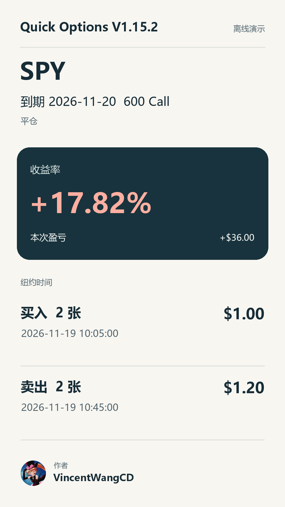

# IBKR 快捷期权 · Quick Options

**VincentWangCD** · Windows · v1.15.2

面向盈透证券的美股与指数期权交易和复盘工具，支持通过 TWS / IB Gateway 管理委托和持仓，通过 Flex 核对历史成交。

A Windows desktop tool for US equity and index options on Interactive Brokers. Use TWS or IB Gateway to manage orders and positions, and IBKR Flex to review executions.

[中文使用说明](#中文使用说明) · [English guide](#english-guide)

## 中文使用说明

通过盈透证券 TWS 或 IB Gateway 查看美股与指数期权链、按预算选合约、管理持仓，并通过 IBKR Flex 同步历史成交。交易功能面向美元计价、合约乘数为 100 的标准期权。

启动时账户列表预选 **IBKR 实盘**，其后依次为 **IBKR 模拟盘** 和 **离线演示**。点击「连接 / 开始」才会连接所选模式。想先试用界面，可以选择离线演示，使用虚构行情和资金。

点窗口右上角的 **English** 切换为英文，点 **简体中文** 切回。工具会记住上次选择的语言。

## 下载安装

1. 在 Windows 安装 [64 位 Python 3.11](https://www.python.org/downloads/windows/)，安装时勾选 **Add python.exe to PATH**。
2. 从仓库的 **Releases** 下载源码包，或点 **Code → Download ZIP**。右键 ZIP 选择「全部提取」，打开能看到 `install.bat` 的那层文件夹。
3. 双击 `install.bat`，等到出现 **Installation complete**。它会在当前目录创建 `.venv`，并按 `requirements.txt` 安装 ib_async、tzdata 和 Pillow。
4. 双击 `start.bat`。第一次可选「离线演示」并点击「连接 / 开始」。装好依赖后，离线演示可直接运行。

## 连接自己的 TWS 或 IB Gateway

1. 在同一台电脑启动 TWS 或 IB Gateway，选择模拟盘或实盘，完成登录。
2. TWS 打开 **File / Edit → Global Configuration → API → Settings**。中文界面通常为「全局配置 → API → 设置」。勾选 **Enable ActiveX and Socket Clients**。如需下单，取消 **Read-Only API**。保持本机连接，记下 **Socket port** 并应用。
3. 打开本工具的「账户设置」，选择和刚才登录一致的模拟盘或实盘，主机填 `127.0.0.1`。Client ID 填同一 TWS 会话中未被其他工具占用的整数。端口与平台显示值一致，常用默认值如下。

   | 平台 | 模拟盘 | 实盘 |
   | --- | ---: | ---: |
   | TWS | 7497 | 7496 |
   | IB Gateway | 4002 | 4001 |

4. 点击「连接 / 开始」，TWS 弹出本机 API 连接请求时确认。只有一个匹配账户时会自动识别，多个账户时从列表选择。检查窗口顶部的账户和模拟 / 实盘标识。期权下单和实时报价取决于账户权限。如果连接失败，先对照模式、端口、Client ID 和 TWS 的连接提示。[IBKR 官方设置教程](https://www.interactivebrokers.com/campus/trading-lessons/installing-configuring-tws-for-the-api/)

## 常用操作

- **开仓和加仓**　在期权链选择标的、到期日、交易类别和 Call / Put。「找档预算」可选可开仓资金的比例或固定美元金额。点击「按预算找档」查看合约、盘口、张数和费用，点击左侧比例按钮恢复普通选档。持仓页的「＋ 加仓」支持按张数、金额和原始本金比例。
- **快捷平仓**　持仓页的 25%、50%、100% 按钮直接提交。当按钮写着「撤止损并平」，工具会撤该合约的保护单，等待回报、核对持仓后提交。右键市价、限价或中间价平仓时可先预览，再点一次确认。若部分平仓，或撤单后平仓未成功，请核对余仓并重新设置需要的保护。
- **止损**　成本倍数 1 为每份持仓成本，1.5 为成本的 1.5 倍。「亏损止损」内有 10% 到 70% 七档，点击某档即可为所选买方持仓全量挂出 DAY 止损。触发价为成本 ×（1 − 所选比例），向上对齐有效报价档，设置时核对当前买一。买一须高于新止损触发价。止损触发后按市价执行，实际成交可能偏离触发价。[IBKR 止损单说明](https://www.interactivebrokers.com/support/faq/content/37137174)
  例如成本 0.10、最小报价单位 0.01 时，10% 仅一档，30% 为三档。更便宜的合约可能因取整而无法表达 10%；工具会提示。
- **账户当日盈亏**　金额取自 TWS 的账户级当日盈亏，币种为账户基础币种。百分比以「当前净清算值 − 当日盈亏」估算期初净值。出入金、净值更新时间与 TWS 重置时间都可能影响对账。未收到数据时显示「—」。[IBKR 盈亏数据说明](https://www.interactivebrokers.com/docs/tws-api/doc/accounts/pnl)
- **成交复盘**　在「成交记录 / 盈亏」选预设范围或自定义起止日。列表按显示时区筛选，区间已实现盈亏按币种汇总。分批成交显示按张数加权的均价，可展开核对明细。顶部列出区间首笔成交，卡片上分别标出成交时间和期权到期日。
- **分享收益图**　点平仓行的「分享收益图」，可预览并导出竖版 PNG。上方显示工具版本，收益率下方是盈亏金额，买卖两行显示本次配对张数、均价和时间。点眼睛可隐藏金额、单价和张数，导出的图片与预览一致。
- **欢乐豆模式和本地记录**　欢乐豆模式隐藏账户与盈亏金额，持仓保留盈亏百分比。分享图不含账户编号，离线演示图会标明「离线演示」。`data/` 保存本机成交与设置，`logs/` 保存使用日志、周报和月报。

### 持仓已有止损时

加仓成交后，原止损维持原来的张数和触发条件。持仓挂有受现有张数覆盖的独立卖出止损时，可以继续买入同一合约，也可以交易其他期权。

点 **一键保本损**（成本倍数为 1，或从持仓右键菜单选择）。工具读取券商回报的最新持仓均价和张数，预检新单，自动撤掉本工具给该合约挂的独立止损。确认旧单状态、期间成交和余仓后，再按最新每份成本向上取到有效报价档，为剩余全部张数挂 DAY 卖出止损，全程只需点击一次。摊低成本后，新保本价也可能降低。若原单已按目标价覆盖全部张数，再点一次会保留原单。

快捷平仓也能撤掉该合约的普通止损、止损限价、移动止损和移动止损限价。撤单期间已经成交的张数计入本次平仓目标。

## 同步历史成交

1. 在 IBKR 客户端门户启用 Flex Web Service，创建 Activity Flex Query。选「交易 → 执行」，包含所需品种和下单渠道，输出格式选 XML，勾选 **IB Execution ID**。
2. 在工具的「Flex 在线同步设置」填入自己的 Token 和 Query ID，报表原始时区按 IBKR 报表填写。例如报表用纽约时间，就选 `America/New_York`，列表仍可用北京时间显示。
3. 连接相应账户后选择日期范围，自选范围点击「应用日期」。工具先显示本地记录，再同步可用报表。起止日期均计入区间。IBKR 返回 1025 时，界面会显示下次重试时间；期间也可从门户下载 XML，点「导入 IBKR Flex 报表…」导入。[IBKR Flex 文档](https://www.interactivebrokers.com/docs/web-api/flex-web-service/error-codes)

## 离线测试与署名

安装依赖后，可在项目目录的 PowerShell 中运行 `.\.venv\Scripts\python.exe run_checks.py`。测试使用合成数据。

项目与收益图署名 **VincentWangCD**。头像角色为《怪盗圣少女》，[同画面美术参考](https://www.bilibili.com/list/ml2402955045?bvid=BV1qs411B7KG&oid=4659227)。本项目由社区独立开发。

## English guide

A bilingual Windows desktop tool for US equity and index options on Interactive Brokers. Browse option chains, size entries by budget, manage positions through TWS or IB Gateway, and review execution history with IBKR Flex. The trading workflow supports standard USD options with a 100 multiplier.

The account selector starts on **IBKR Live**, followed by **IBKR Paper** and **Offline Demo**. Click **Connect / Start** to connect to your selection. To try the interface with synthetic quotes and funds, select Offline Demo first.

Click **English** in the top-right corner to switch the running tool to English. Click **简体中文** to switch back. Your choice is remembered on this computer.

## Install on Windows

1. Install 64-bit Python 3.11 from [python.org](https://www.python.org/downloads/windows/). Select **Add python.exe to PATH** in the installer.
2. Download the source ZIP from the repository's **Releases** or **Code → Download ZIP**. Extract it to a writable folder. Open the folder containing `install.bat`.
3. Double-click `install.bat`. It creates a local `.venv` and installs the pinned dependencies in `requirements.txt`, including ib_async, tzdata and Pillow. Wait for **Installation complete**.
4. Double-click `start.bat`. Select **Offline demo (simulated quotes)** and click **Connect / Start** to try the workflow. Offline mode works without TWS or an IBKR account after installation.

## Connect TWS or IB Gateway

1. Start TWS or IB Gateway on the same Windows PC, select **Paper Trading** or **Live Trading**, and finish signing in.
2. In TWS, open **File / Edit → Global Configuration → API → Settings** (menu names vary by layout). Enable **Enable ActiveX and Socket Clients**. To submit orders, clear **Read-Only API**. Keep localhost access and enter the configured **Socket port** below. Apply the settings.
3. In Quick Options, open **Account / Disconnect**, choose IBKR paper or live to match the session, and use host `127.0.0.1`. Enter a unique **Client ID** and the same port. TWS defaults are **7497 paper / 7496 live**. IB Gateway defaults are **4002 paper / 4001 live**. The value shown by your running platform takes precedence.
4. Click **Connect / Start** and approve the local API connection if TWS asks. With one matching account the tool selects it. With multiple accounts it asks you to select one. Check the connection banner. Option order permissions and real-time quotes depend on your IBKR account. For connection errors, check mode, port, client ID and TWS's API prompt. [IBKR setup guide](https://www.interactivebrokers.com/campus/trading-lessons/installing-configuring-tws-for-the-api/)

## Use the tool

- **Entry.** Choose the symbol, expiry, trading class and Call/Put. Use a percentage of available opening funds or a fixed USD budget in **Strike budget**, then **Find by budget** to locate a contract. Review bid/ask, quantity and terms before submitting. Clicking a percentage preset exits budget search.
- **Positions.** Direction arrows indicate exposure to the underlying. Use **＋ Add…** to add by quantity, USD amount or a percentage of initial capital. The 25%, 50% and 100% toolbar exits submit immediately. If the button says **Cancel stop and close**, it cancels only the identified protection for that contract, waits for the broker, rechecks the holding, then submits the exit. The context menu opens a preview with one confirmation. After a partial exit or an unsuccessful replacement, check the remaining position and reset protection as needed.
- **Stops.** A cost multiple of 1 uses the per-unit entry cost, 1.5 uses 150% of cost. The loss menu offers 10% to 70% in ten-point steps. Choosing a preset requests a DAY stop for the entire selected long position. The trigger is cost × (1 − loss fraction), rounded up to a valid tick. The current bid must be above the proposed stop trigger. Stop execution can differ from the trigger price. [IBKR stop orders](https://www.interactivebrokers.com/support/faq/content/37137174)
  For a 0.10 entry and a 0.01 minimum tick, 10% is one tick and 30% is three. The tool flags a preset that rounds back to entry.
- **Account daily P&L.** Uses TWS account-level daily P&L in the account's base currency. The displayed percentage estimates starting equity as current net liquidation minus daily P&L. Cash transfers, stale values and TWS reset times can affect comparison with a statement. An unavailable figure is displayed as a dash. [IBKR P&L API](https://www.interactivebrokers.com/docs/tws-api/doc/accounts/pnl)
- **Execution history.** Choose a preset or enter a start and end date. The display timezone determines which fills fall in the range. Realized P&L is summed per currency. Expand an order to inspect partial fills. The summary identifies the first visible fill. Cards label the fill timestamp and the option expiry separately.
- **Share cards.** Open a closing order’s share card to preview or save a portrait PNG. It includes the app version, the return percentage above the realized amount, and the matched quantity, price and time on each available leg. Use the eye button to hide amounts, prices and quantities in both the preview and the saved image.
- **Privacy.** **Happy Beans** masks account and P&L amounts. Share images omit account identifiers. The demo marks its images. The tool stores execution history in `data/` and usage logs and periodic summaries in `logs/`.

### Trading while a stop is working

After an add fills, the original stop keeps its quantity and trigger terms. A covered, independent sell stop allows you to buy more of the same contract or trade another option.

Click **Break-even stop** with the cost multiple set to 1, or use the position’s context menu. Quick Options reads the latest average cost and quantity from the broker, checks the proposed order and cancels the independent stops it placed on that contract. Once it confirms their final status, intervening fills and the remaining position, it submits a DAY sell stop for the remaining contracts at the current per-unit cost rounded up to a valid tick. Averaging down can lower the new trigger. A second click keeps a working stop that already covers the position at the target price.

Quick exits recognize stop, stop-limit, trailing-stop and trailing-stop-limit orders. Fills during cancellation count toward the requested exit quantity.

## Sync execution history

1. Enable Flex Web Service in IBKR Client Portal. Create an Activity Flex Query with Trades → Executions, **IB Execution ID**, your desired asset classes and order channels, and XML output.
2. Enter your Flex token and query ID in the app's Flex settings. Set the statement timezone to the timezone used in the report. A New York statement can be viewed in Beijing time.
3. Connect to the matching account, then select a preset or apply a custom date range. Both dates are inclusive. The app displays local fills and automatically syncs available reports. If IBKR returns 1025, the app displays its next retry time. You can also download the query as XML in Client Portal and import it in the app. [IBKR Flex error codes](https://www.interactivebrokers.com/docs/web-api/flex-web-service/error-codes)

## Offline checks and credits

From PowerShell in the extracted folder, run `.\.venv\Scripts\python.exe run_checks.py` after installation. These tests use synthetic data.

Project and share-card signature: **VincentWangCD**. The avatar depicts *Saint Tail*. [Artwork reference](https://www.bilibili.com/list/ml2402955045?bvid=BV1qs411B7KG&oid=4659227). This community tool is independent of Interactive Brokers.
